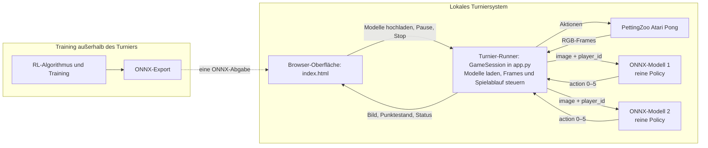
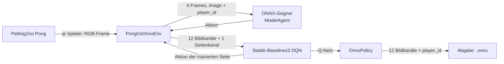

# RL Challenge: Atari Pong

In dieser Challenge entwickeln Gruppen eine Policy für **Atari Pong**. Im
Turnier trifft sie auf einen zuvor nicht bekannten Gegner. Ihr verändert nicht
die Spielumgebung, sondern trainiert eine Policy und reicht sie als portable
ONNX-Datei ein.

## Auf einen Blick

| Was? | Vorgabe |
| --- | --- |
| Technische Abgabe | Genau eine `.onnx`-Datei pro Gruppe, höchstens 250 MB, ONNX Opset 17. |
| Lokaler Test | Zwei ONNX-Modelle im Browser gegeneinander spielen lassen. Das zweite Modell ist nur ein Testgegner, keine zweite Abgabe. |
| Bericht | 5–8 Seiten als Grundlage der Endnote. |
| Vorbereitung | 30.10.2026 (diesen Freitag). |
| Präsentation und Turnier | 13.11.2026, Präsentation der Ergebnisse in 10 Minuten. |

## 1. Schnellstart: Runner und Baselines testen

Der lokale Runner führt die Turnierumgebung auf eurem Rechner aus. Er verwendet
ONNX Runtime auf CPU; zum **Ausführen** einer Abgabe ist keine GPU nötig.

```bash
cd rl-challenge
python -m venv .venv
source .venv/bin/activate
python -m pip install -r requirements.txt
AutoROM --accept-license
python create_baselines.py
PORT=5001 python app.py
```

Anschließend [http://127.0.0.1:5001](http://127.0.0.1:5001) öffnen. Unter
Windows wird die virtuelle Umgebung mit `.venv\Scripts\Activate.ps1`
aktiviert.

Zum ersten Test im Browser diese beiden Dateien auswählen:

| Datei | Zweck |
| --- | --- |
| `baselines/baseline_pong_static.onnx` | Absichtlich schwache Policy, die nur `FIRE` ausgibt; Upload-/Schnittstellentest. |
| `baselines/baseline_pong_track_ball.onnx` | Deterministische bildbasierte Policy: Sie erkennt Ball und eigenen Schläger über Pixel-Farben und steuert in Ballrichtung. Kein trainiertes Modell. |

## 2. Aufgabe und Turnierablauf

Eine Policy soll den Ball mit dem eigenen Schläger abfangen und am Gegner
vorbeispielen. Der Gegner im eigentlichen Turnier ist während des Trainings
nicht bekannt. Das Browser-Turnier vergleicht deshalb zwei unabhängig
hochgeladene Modelle.

### Architektur: Training ist nicht der Turnier-Runner

| Baustein | Aufgabe |
| --- | --- |
| Arena | [PettingZoo Atari Pong (`pong_v3`)](https://pettingzoo.farama.org/main/environments/atari/pong/) mit zwei Spielern. |
| Browser-Oberfläche | [`index.html`](index.html) lässt zwei Modelle auswählen und zeigt Arena, Punktestand und Status. |
| Turnier-Runner | `GameSession` in [`app.py`](app.py) lädt beide ONNX-Modelle, ruft sie pro Frame auf und verwaltet Frame-Stack, Seitenwechsel, Runden und Punkte. |
| Modell | Reine ONNX-Policy-Inferenz: Sie erhält nur `image` und `player_id` und gibt eine Aktion zurück. Sie hat keinen direkten Zugriff auf Environment, Punktestand oder gegnerische Aktion. |
| Training | Eigene, von der Gruppe gewählte Offline-/Trainingsprogramme. Die Beispiele im Repository erzeugen ONNX-Dateien, sind aber nicht Teil des Turnier-Runners. |



### Regeln einer Partie

Ein Duell besteht aus zehn Runden. Seeds und Seiten sind im aktuellen Runner
festgelegt und damit reproduzierbar:

| Runde | Seed | Upload „Spieler 1“ | Upload „Spieler 2“ |
| ---: | ---: | --- | --- |
| 1, 3, 5, 7, 9 | 42, 44, 46, 48, 50 | links / orange (`player_id=1`) | rechts / grün (`player_id=2`) |
| 2, 4, 6, 8, 10 | 43, 45, 47, 49, 51 | rechts / grün (`player_id=2`) | links / orange (`player_id=1`) |

Damit spielt jedes Modell fünf Runden auf jeder Seite. Pro Runde gilt:

- Ein positiver Environment-Reward zählt als ein Punkt für das zugehörige
  hochgeladene Modell; anschließend beginnt die nächste Runde.
- Nach maximal **2.000** Environment-Schritten ohne positiven Punkt oder bei
  einer technisch beendeten Runde ohne positiven Punkt ist die Runde ein
  Unentschieden. Beide Uploads erhalten dann je einen Turnierpunkt.
- Ein negativer Reward allein wird vom Runner nicht als eigener Turnierpunkt
  verbucht.
- Nach zehn Runden gewinnt der Upload mit mehr aggregierten Turnierpunkten;
  Gleichstand bedeutet Unentschieden.

Die Browser-Oberfläche zeigt Punktestand und aktuelle Seiten. Eine Partie lässt
sich pausieren, fortsetzen oder stoppen. Beim Stoppen endet sie ohne
nachträgliche Gewinnerbestimmung.

## 3. Was muss das Modell können?

### Öffentlicher Modellvertrag

Der Runner akzeptiert genau zwei Eingaben mit genau diesen Namen und eine
Ausgabe mit genau diesem Namen:

```text
image:     float32 [1, 12, 210, 160]
player_id: int64   [1]
action:    int64   [1]    # Wert aus {0, 1, 2, 3, 4, 5}
```

Die Abgabe soll mit **ONNX Opset 17** exportiert werden und höchstens 250 MB
groß sein. Sie wird mit ONNX Runtime auf CPU ausgeführt. Der Runner prüft beim
Laden Namen, Typen und feste Formen; er prüft das Opset nicht gesondert. Ein
anderes Opset kann zwar zufällig ladbar sein, erfüllt aber nicht die
Abgabevorgabe.

### State / Beobachtung

PettingZoo liefert pro Spieler einen RGB-Frame der Form `210 × 160 × 3`
(`H × W × RGB`, `uint8`). Der Runner hält pro physischem Pong-Spieler die
letzten vier Frames fest:

1. Beim Start einer Runde besteht die History aus vier identischen
   Startframes.
2. Danach wird nach jedem Environment-Schritt der neue Frame angehängt.
3. Der Runner ordnet die vier Frames vom ältesten zum neuesten an, wandelt
   `HWC` nach `NCHW` und stapelt sie zu zwölf Kanälen.
4. Anschließend konvertiert er nach `float32` und dividiert durch `255`; die
   Pixelwerte liegen somit in `[0, 1]`.

Damit belegen die Kanäle `0–2` den ältesten und `9–11` den neuesten RGB-Frame.
Die Bildfolge kann einer Policy helfen, Bewegung zu schätzen.

`player_id` bezeichnet **die physische Seite**, nicht den Upload-Slot im
Browser:

| `player_id` | Seite und Farbe |
| ---: | --- |
| `1` | links / orange |
| `2` | rechts / grün |

Ein Modell muss daher beide Werte verarbeiten können, wenn es auf beiden
Seiten spielen soll. Ein Modell darf `player_id` technisch nicht weglassen,
auch wenn es die Eingabe intern nicht nutzt.

### Aktionen

Die Werte entsprechen dem minimalen Action-Space von PettingZoo Pong. Die
offiziellen Richtungsnamen beziehen sich auf den Atari-Controller und sind
nicht als Bildschirmkoordinaten „oben/unten“ dokumentiert.

| Wert | PettingZoo-/ALE-Bedeutung |
| ---: | --- |
| `0` | `NOOP` – keine Eingabe |
| `1` | `FIRE` – feuern bzw. Aufschlag starten |
| `2` | `RIGHT` – nach rechts bewegen |
| `3` | `LEFT` – nach links bewegen |
| `4` | `FIRE_RIGHT` – feuern und nach rechts bewegen |
| `5` | `FIRE_LEFT` – feuern und nach links bewegen |

Insbesondere bedeutet `3` **nicht** `DOWN`, und `4`/`5` sind nicht
`FIRE_UP`/`FIRE_DOWN`. Bei einem stillstehenden Ball kann `FIRE` den nächsten
Ballwechsel auslösen; der Pong-Aufschlag ist zeitbegrenzt.

## 4. Training: eigene Methode wählen

Die Trainingsprogramme sind Startpunkte. Sie definieren weder den einzigen
zulässigen Algorithmus noch eine faire Evaluation im Turnier.

### DQN-Minimalbeispiel

[`train_dqn_vanilla.py`](train_dqn_vanilla.py) ist der kurze, kommentierte
Einstieg. Es erzeugt DQN, startet das Lernen und exportiert ONNX. Der
Zwei-Spieler-Adapter [`pong_opponent_env.py`](pong_opponent_env.py) baut Pong
gegen ein **wählbares ONNX-Gegnermodell** auf und benutzt dafür dieselbe
`ModelAgent`-Schnittstelle wie der Turnier-Runner. Das Beispiel trainiert
standardmäßig auf **beiden Seiten abwechselnd** gegen die Ball-Tracking-
Baseline. Intern ergänzt die Trainingsumgebung zu den zwölf Bildkanälen einen
13. Kanal mit der Seite (`0` für links, `1` für rechts). Das Q-Netz erhält
dieses Seitenmerkmal zusätzlich zu den Bildmerkmalen. Beim ONNX-Export erzeugt
das Modell diesen Kanal aus der verpflichtenden öffentlichen Eingabe
`player_id`; die Turnier-Schnittstelle selbst bleibt also unverändert. Es
beschneidet das Spielfeld,
verwendet Graustufen, `84 × 84` Pixel und vier Trainingsframes. Diese
Vorverarbeitung liegt im PyTorch-Netz selbst: Der Environment-Adapter stapelt
und normalisiert nur die vier Rohframes zum öffentlichen 12-Kanal-Format;
Beschneiden, Graustufen und Skalieren werden beim ONNX-Export unverändert Teil
des Modells.

```bash
python create_baselines.py
python train_dqn_vanilla.py --timesteps 1000000 \
  --opponent baselines/baseline_pong_track_ball.onnx \
  --output baselines/baseline_pong_dqn.onnx
```

### Tutorial: Was geschieht in diesem Beispiel?

Das Beispiel besteht aus genau zwei Dateien mit unterschiedlichen Aufgaben:

| Datei | Aufgabe |
| --- | --- |
| [`pong_opponent_env.py`](pong_opponent_env.py) | Macht aus Pong mit zwei Spielern eine Gymnasium-Umgebung: Eine Seite wird trainiert, die andere wird von einer ONNX-Datei gesteuert. |
| [`train_dqn_vanilla.py`](train_dqn_vanilla.py) | Baut das DQN, ruft `learn()` auf und exportiert das Ergebnis wieder als ONNX-Datei. |

Die folgende Abbildung beschreibt einen Trainingsschritt. Wichtig: Der
ONNX-Gegner und der spätere Turnier-Runner sehen das **öffentliche** Format;
das trainierte DQN bekommt zusätzlich ein internes Seitenmerkmal.



#### Schritt 1: Einen Gegner wählen

Vor dem Training erzeugt `create_baselines.py` die beiden Beispielmodelle.
Die Standardoption `baseline_pong_track_ball.onnx` verfolgt Ball und eigenen
Schläger, ist aber kein gelerntes Modell. Sie ist ein reproduzierbarer,
fester Trainingsgegner.

```bash
python create_baselines.py
python train_dqn_vanilla.py \
  --opponent baselines/baseline_pong_track_ball.onnx
```

Jede turnierkompatible ONNX-Datei kann Gegner sein:

```bash
python train_dqn_vanilla.py --opponent pfad/zu/gegner.onnx
```

Der Adapter lädt den Gegner über `ModelAgent` aus `app.py`. Er erhält daher
seine eigenen vier Rohframes, seine echte `player_id` und wird mit ONNX
Runtime auf CPU ausgeführt — genauso wie im Browser-Turnier.

#### Schritt 2: Eine Zwei-Spieler-Arena wird zu einer Lernumgebung

Pong liefert gleichzeitig Beobachtungen und Rewards für beide physischen
Spieler. DQN kann dagegen nur einen Agenten trainieren. `PongVsOnnxEnv`
übernimmt deshalb pro Episode eine Seite als trainierten Agenten und spielt
die andere mit dem gewählten ONNX-Gegner.

`--player-id 0` ist der Standard: Bei jedem `reset()` wird zufällig links
oder rechts als trainierte Seite gewählt. Damit lernt das Beispiel beide
physischen Rollen. Alternativ erzwingen diese Aufrufe eine einzelne Seite:

```bash
# nur links/orange trainieren
python train_dqn_vanilla.py --player-id 1

# nur rechts/grün trainieren
python train_dqn_vanilla.py --player-id 2
```

Eine Episode endet nach einem Punkt, einem technischen Ende der Arena oder
nach 1.000 Schritten ohne Punkt. Beim Timeout wird die Episode abgeschnitten
(`truncated=True`) und der Reward bleibt `0`. Das ist nur eine
Trainingsentscheidung; im Turnier gilt die eigene 2.000-Schritte-Regel.

#### Schritt 3: Beobachtung und `player_id`

Die ersten zwölf Kanäle sind genau die spätere ONNX-Eingabe: vier RGB-Frames,
ältester zuerst, normalisiert auf Werte von `0` bis `1`. Für DQN ergänzt die
Trainingsumgebung intern einen dreizehnten Kanal:

| Kanal(e) im DQN-Training | Inhalt |
| --- | --- |
| `0–11` | Vier öffentliche RGB-Frames (`4 × 3` Kanäle) |
| `12` | überall `0` für links/orange (`player_id=1`) bzw. `1` für rechts/grün (`player_id=2`) |

`PongCNN` beschneidet aus den zwölf Bildkanälen das Spielfeld, wandelt in
Graustufen um und skaliert auf `84 × 84`. Das CNN erzeugt daraus 512
Bildmerkmale. Der konstante Seitenwert wird als 513. Merkmal angehängt.
Dadurch kann das Q-Netz wirklich unterschiedliche Entscheidungen für beide
Seiten lernen.

Die Abgabe bleibt trotzdem beim verpflichtenden öffentlichen Vertrag mit
zwölf Bildkanälen. `OnnxPolicy` erzeugt beim Export den internen 13. Kanal
erst aus `player_id`. Deshalb ist `player_id` keine Export-Krücke, sondern
eine echte Eingabe des gelernten Q-Netzes.

#### Schritt 4: Was DQN lernt

DQN schätzt für jede Aktion einen Q-Wert: den erwarteten zukünftigen Reward.
Das Netz liefert sechs Werte und wählt während der Ausführung die Aktion mit
dem größten Wert (`argmax`). Der Pong-Reward des trainierten Spielers wird
unverändert an DQN weitergegeben: Ein gewonnener Ballwechsel ist positiv,
ein verlorener negativ; während des Ballwechsels ist er normalerweise null.

Die im Beispiel fest eingestellten Werte sind typische Atari-Startwerte,
keine Challenge-Regeln:

| Einstellung | Wert | Bedeutung |
| --- | ---: | --- |
| Replay-Buffer | 100.000 | Vergangene Übergänge, aus denen DQN zufällig lernt. |
| Anfangszufall | 80.000 Schritte | Vor den ersten Updates wird zunächst Erfahrung gesammelt. |
| Exploration | von 1,0 auf 0,01 in 40 % des Laufs | Zu Beginn viele zufällige Aktionen, später überwiegend beste bekannte Aktion. |
| Batch-Größe | 32 | Übergänge pro Lernupdate. |
| Update-Frequenz | alle 4 Schritte | Wie oft DQN seine Gewichte aktualisiert. |
| Target-Netz-Update | alle 1.000 Schritte | Stabilisiert die Q-Lernziele. |

Für einen reinen Pipeline-Test genügt ein kurzer Lauf. Er erzeugt bereits
eine ONNX-Datei, kann wegen der 80.000 Anfangsschritte aber noch nichts
Sinnvolles gelernt haben:

```bash
python train_dqn_vanilla.py --timesteps 1000 --export-every 500 \
  --output baselines/smoke_test.onnx
python validate_submission.py baselines/smoke_test.onnx
```

Ein erster ernsthafter Versuch benötigt deutlich mehr Schritte. Für einen
längeren GPU-Lauf genügen dieselben Optionen, etwa:

```bash
python train_dqn_vanilla.py --device cuda --timesteps 5000000 \
  --opponent baselines/baseline_pong_track_ball.onnx \
  --export-every 250000 \
  --output baselines/baseline_pong_dqn.onnx
```

#### Schritt 5: Checkpoints, Export und Test

Alle `--export-every` Schritte schreibt das Skript zwei Dateien mit derselben
Schrittnummer:

| Datei | Zweck |
| --- | --- |
| `…_step_N.zip` | Stable-Baselines3-Checkpoint; nur zum Fortsetzen oder Analysieren des Trainings. |
| `…_step_N.onnx` | Portable Policy für Validator und Browser-Runner. |

Nach Ende des Laufs entstehen außerdem der finale Export aus `--output` und
eine gleichnamige `.zip`-Datei. Nur die `.onnx`-Datei ist eine mögliche
Abgabe. Vor dem Turnier sollten Gruppen sie erst technisch validieren und
dann im Browser gegen eine Baseline testen:

```bash
python validate_submission.py baselines/baseline_pong_dqn.onnx
PORT=5001 python app.py
```

Mit `--opponent andere_policy.onnx` lässt sich jeder technisch kompatible
ONNX-Gegner wählen; `--player-id 1` trainiert nur links/orange,
`--player-id 2` nur rechts/grün und `--player-id 0` (Standard) wechselt die
Seite je Episode. Das Beispiel ist eine Startvorlage, keine Referenz für eine
faire Turnierevaluation: Sein Trainings-Timeout beträgt 1.000 Schritte statt 2.000
und es sieht jeweils nur einen festen Gegner. Für eine belastbare Evaluation
sind weitere Gegner, beide Seiten und getrennte Tests sinnvoll. Training kann
CPU, Apple Silicon oder CUDA verwenden. Eine GPU kann längere Läufe
beschleunigen, ist aber weder für alle Gruppen noch für die Ausführung der
Abgabe erforderlich.

### Offene methodische Entscheidungen

Folgende Entscheidungen sind absichtlich nicht durch den Runner festgelegt und
sollten im Bericht begründet werden:

- State-Design: vollständige Bilder, gestapelte Frames oder zulässige intern
  aus Bildern abgeleitete Merkmale;
- Reward Shaping beim Training;
- feste Gegner, Self-Play oder ein Gegner-Pool;
- Training für beide Seiten und der Umgang mit `player_id`;
- faire Evaluation, etwa über mehrere Seeds, beide Seiten und mehrere Gegner.

Das Browser-Turnier deckt bereits zehn feste Runden und beide Seiten ab. Für
eine belastbare Aussage über Spielstärke empfiehlt sich zusätzlich eine eigene
Evaluation über mehr Seeds und unterschiedliche Gegner.

## 5. PyTorch-Modell exportieren und prüfen

Für eine PyTorch-Policy sind beim Export vier Dinge wichtig:

1. `forward` nimmt beide Eingaben in der Reihenfolge `image, player_id` an.
2. Die Ausgabe ist ein `torch.int64`-Tensor der Form `[1]`, nicht etwa
   Aktionswahrscheinlichkeiten oder Q-Werte.
3. `eval()` schaltet das Modell in den Inferenzmodus. Die Beispieltensoren
   haben exakt die öffentliche Form und Datentypen.
4. `player_id` muss im Rechengraphen verwendet werden. Wird es ignoriert,
   kann PyTorch die Eingabe beim Export entfernen und der Runner lehnt das
   Modell ab.

Dieses absichtlich schwache Modell ist ein vollständiger technischer
Exporttest:

```python
import torch


class Policy(torch.nn.Module):
    def forward(self, image: torch.Tensor, player_id: torch.Tensor) -> torch.Tensor:
        # Absichtlich keine starke Policy: Sie verwendet aber beide Eingaben.
        side_action = player_id - 1
        pixel_action = (image[:, 0, 0, 0] > 0.5).to(torch.int64)
        return (side_action + pixel_action).clamp(0, 5)


policy = Policy().eval()
image = torch.zeros((1, 12, 210, 160), dtype=torch.float32)
player_id = torch.ones((1,), dtype=torch.int64)
torch.onnx.export(
    policy,
    (image, player_id),
    "my_policy.onnx",
    input_names=["image", "player_id"],
    output_names=["action"],
    opset_version=17,
)
```

Danach den Export technisch prüfen:

```bash
python validate_submission.py my_policy.onnx
```

Der Validator lädt das Modell mit der CPU-Laufzeit und prüft Schnittstelle
sowie Aktionsbereich mit leeren Testframes für beide Seiten. Er bewertet
**nicht** die Spielstärke und prüft weder Dateigröße noch ONNX-Opset
vollständig. Diese beiden Abgabevorgaben müssen zusätzlich eingehalten werden.

## 6. Abgabe und Bericht

Pro Gruppe ist **genau eine `.onnx`-Datei** einzureichen. Eine zusätzliche
Projekt-README kann hilfreich sein, wird vom Runner aber nicht verwendet. Der
Bericht ist eine separate Kursleistung und bildet mit 5–8 Seiten die Grundlage
der Endnote. Er soll mindestens behandeln:

- Spielbeschreibung sowie State/Observation, Aktionen und Reward,
- gewählten RL-Algorithmus und Trainingsaufbau,
- Umgang mit zwei Spielern, unbekanntem Gegner und Seitenwechsel,
- Evaluation der Spielstärke und deren Grenzen.

Vor der Abgabe die ONNX-Datei validieren und lokal gegen einen Testgegner
spielen lassen. Bei der Präsentation am **13.11.2026** stellt jede Gruppe ihr
Vorgehen und ihre Ergebnisse in **10 Minuten** vor; der Vorbereitungstermin
ist am **30.10.2026**.
