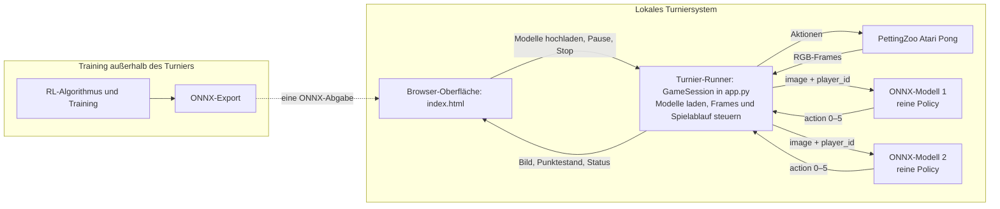

# RL Challenge: Atari Pong

**Deutsch** · [English version](README_EN.md)

In dieser Challenge entwickeln Sie in **Zweiergruppen** eine Policy für
**Atari Pong**. Im Turnier trifft sie auf einen zuvor nicht bekannten Gegner.
Sie verändern nicht die Spielumgebung, sondern trainieren eine Policy, reichen
sie als portable ONNX-Datei ein und präsentieren Vorgehen und Ergebnisse in
einem zehnminütigen Vortrag.


*Abbildung: Atari Pong aus der [offiziellen PettingZoo-Pong-Dokumentation](https://pettingzoo.farama.org/main/environments/atari/pong/), Farama Foundation.*

## Auf einen Blick

| Was? | Vorgabe |
| --- | --- |
| Team | Zweiergruppe; beide Mitglieder stimmen Methode, Experimente und Vortrag gemeinsam ab. |
| Technische Abgabe | Genau eine `.onnx`-Datei pro Gruppe, höchstens 250 MB, ONNX Opset 17. |
| Lokaler Test | Zwei ONNX-Modelle im Browser gegeneinander spielen lassen. Das zweite Modell ist nur ein Testgegner, keine zweite Abgabe. |
| Bericht | 5–8 Seiten als Grundlage der Endnote. |
| Vorbereitung | 30.10.2026 (diesen Freitag). |
| Präsentation und Turnier | 13.11.2026; 10 Minuten pro Gruppe, beide Gruppenmitglieder beteiligen sich. |

Der Ablauf der Challenge ist damit:

```text
Gemeinsamer technischer Einstieg
        ↓
Arbeit und Experimente in Zweiergruppen
        ↓
Bericht (5–8 Seiten) und fertige ONNX-Policy
        ↓
10-Minuten-Vortrag und Turnier
```

## 1. Vorbereitung und gemeinsamer Durchlauf

Ziel des gemeinsamen Durchlaufs ist, dass jede Person einmal die vollständige
Kette ausführt:

```text
Baseline erzeugen → ONNX validieren → Duell starten → DQN kurz ausführen → eigenen Export testen
```

### Einmalige Vorbereitung

Empfohlen ist **Python 3.11**. Der lokale Runner verwendet ONNX Runtime auf
CPU; zum Ausführen einer Abgabe ist keine GPU nötig.

Alternativ kann der gemeinsame Durchlauf vollständig in Google Colab geöffnet
werden:

[](https://colab.research.google.com/github/georgmerz/rl-challenge/blob/main/RL_Challenge_Colab.ipynb)

Das Notebook installiert die Abhängigkeiten und Atari-ROMs, erzeugt die
Baselines, öffnet den Browser-Runner in einem Colab-iframe und führt den kurzen
DQN-/ONNX-Test aus. Der Colab-Speicher ist temporär; erzeugte Modelle müssen am
Ende heruntergeladen werden.

```bash
cd rl-challenge
python -m venv .venv
source .venv/bin/activate
python -m pip install -r requirements.txt
AutoROM --accept-license
```

Unter Windows wird die virtuelle Umgebung mit
`.venv\Scripts\Activate.ps1` aktiviert. Dieser kurze Test prüft zusätzlich,
ob die Pong-ROM gefunden wird:

```bash
python -c "from pettingzoo.atari import pong_v3; env = pong_v3.parallel_env(); env.reset(seed=42); env.close(); print('Setup und Pong-ROM: OK')"
```

### Gemeinsam in der Vorlesung

#### 1. Zwei einfache Policies erzeugen und validieren

```bash
python create_baselines.py
python validate_submission.py baselines/baseline_pong_static.onnx
python validate_submission.py baselines/baseline_pong_track_ball.onnx
```

Beide Validator-Aufrufe müssen mit `OK` enden. Dabei wird bereits der zentrale
Unterschied sichtbar: Ein Modell kann technisch korrekt und trotzdem
spielerisch schwach sein.

#### 2. Ein Duell im Browser ausführen

```bash
PORT=5001 python app.py
```

Unter Windows PowerShell lautet derselbe Startbefehl
`$env:PORT=5001; python app.py`.
Anschließend [http://127.0.0.1:5001](http://127.0.0.1:5001) öffnen und diese
Modelle auswählen:

| Datei | Zweck |
| --- | --- |
| `baselines/baseline_pong_static.onnx` | Absichtlich schwache Policy, die nur `FIRE` ausgibt; Upload-/Schnittstellentest. |
| `baselines/baseline_pong_track_ball.onnx` | Deterministische bildbasierte Policy: Sie erkennt Ball und eigenen Schläger über Pixel-Farben und steuert in Ballrichtung. Kein trainiertes Modell. |

Gemeinsam sollten einmal **Start**, **Pause**, **Fortsetzen** und **Stop**
ausprobiert sowie Seitenwechsel und Punktestand beobachtet werden.

#### 3. Den Trainings- und Exportweg einmal vollständig ausführen

In einem zweiten Terminal die virtuelle Umgebung aktivieren und einen sehr
kurzen Lauf starten:

```bash
python train_dqn_vanilla.py --timesteps 128 --export-every 128 \
  --output baselines/lecture_smoke.onnx
python validate_submission.py baselines/lecture_smoke.onnx
```

Dieser Lauf testet Environment, DQN und ONNX-Export, trainiert aber noch keine
sinnvolle Policy: Das Beispiel beginnt erst nach 5.000 Schritten mit Updates.
Anschließend kann `lecture_smoke.onnx` im Browser gegen eine Baseline geladen
werden. Damit hat jede Person den späteren eigenen
Abgabeweg einmal vollständig durchlaufen.

Nach diesem Durchlauf sollten alle Teilnehmenden:

- eine technisch gültige ONNX-Policy erzeugen und validieren können,
- den Unterschied zwischen technischer Gültigkeit und Spielstärke erklären,
- `image`, `player_id` und `action` im Modellvertrag zuordnen können und
- wissen, wo Turnierregeln, Trainingsumgebung und eigenes Modell getrennt
  implementiert sind.

### Empfohlene Reihenfolge beim Lesen des Codes

| Datei | Leitfrage |
| --- | --- |
| [`create_baselines.py`](create_baselines.py) | Wie wird aus einer einfachen Policy eine ONNX-Datei? |
| [`validate_submission.py`](validate_submission.py) | Was prüft technische Kompatibilität — und was nicht? |
| [`app.py`](app.py) | Wie ruft der Runner zwei Modelle auf und wertet ein Duell aus? |
| [`pong_opponent_env.py`](pong_opponent_env.py) | Wie wird die Zwei-Spieler-Arena für ein Einzelagenten-DQN adaptiert? |
| [`train_dqn_vanilla.py`](train_dqn_vanilla.py) | Wie greifen Vorverarbeitung, DQN, Checkpoints und Export ineinander? |

Wenn ein Schritt scheitert, zuerst prüfen: Ist die virtuelle Umgebung aktiv?
Wurde `requirements.txt` installiert? Wurde `AutoROM --accept-license`
ausgeführt? Ist Port 5001 belegt, kann stattdessen etwa `PORT=5002` verwendet
werden.

## 2. Aufgabe und Turnierablauf

Eine Policy soll den Ball mit dem eigenen Schläger abfangen und am Gegner
vorbeispielen. Der Gegner im eigentlichen Turnier ist während des Trainings
nicht bekannt. Das Browser-Turnier vergleicht deshalb zwei unabhängig
hochgeladene Modelle.

> **Verbindliche Turnierregeln:** [`app.py`](app.py) ist die maßgebliche
> Implementierung für Rundenanzahl, Seitenwechsel, Seeds, Timeout, Punkte,
> Gewinner und die ONNX-Schnittstelle. PettingZoo/ALE definiert dagegen die
> eigentliche Pong-Spielmechanik, Aktionen und Environment-Rewards. Regeln
> eines Trainingsbeispiels (etwa ein Trainings-Timeout) gelten nicht
> automatisch für das Turnier.

### Architektur: Training ist nicht der Turnier-Runner

| Baustein | Aufgabe |
| --- | --- |
| Arena | [PettingZoo Atari Pong (`pong_v3`)](https://pettingzoo.farama.org/main/environments/atari/pong/) mit zwei Spielern. |
| Browser-Oberfläche | [`index.html`](index.html) lässt zwei Modelle auswählen und zeigt Arena, Punktestand und Status. |
| Turnier-Runner | `GameSession` in [`app.py`](app.py) lädt beide ONNX-Modelle, ruft sie pro Frame auf und verwaltet Frame-Stack, Seitenwechsel, Runden und Punkte. |
| Modell | Reine ONNX-Policy-Inferenz: Sie erhält nur `image` und `player_id` und gibt eine Aktion zurück. Sie hat keinen direkten Zugriff auf Environment, Punktestand oder gegnerische Aktion. |
| Training | Eigene, von der Gruppe gewählte Offline-/Trainingsprogramme. Die Beispiele im Repository erzeugen ONNX-Dateien, sind aber nicht Teil des Turnier-Runners. |



### Was ist ONNX?

**ONNX** (*Open Neural Network Exchange*) ist ein portables Dateiformat für
fertig trainierte neuronale Netze. Sie können ein Modell zum Beispiel mit
PyTorch trainieren und anschließend als `.onnx` exportieren. Der
Turnier-Runner benötigt weder Ihren Trainingscode noch PyTorch: Er lädt nur
die ONNX-Datei mit ONNX Runtime auf CPU und ruft ihre Policy auf.

```text
Training mit PyTorch / Stable-Baselines3  →  Export als .onnx  →  Browser-Runner
       Gewichte werden gelernt               feste Schnittstelle     nur Inferenz
```

Eine ONNX-Datei enthält damit Architektur und gelernte Gewichte für die
Inferenz, aber nicht Replay-Buffer, Optimierer, Trainingsdaten oder Python-
Klassen. Sie ist die **technische Abgabe**. Damit der Runner sie ausführen
kann, muss sie genau die in Abschnitt 3 beschriebene Eingabe `image` und
`player_id` sowie die Ausgabe `action` bereitstellen.

Kurz gesagt exportiert man nach dem Training ein PyTorch-Modell mit
`torch.onnx.export(...)`. Die Beispieltensoren müssen dabei genau dem
Turniervertrag entsprechen:

```python
model.eval()
image = torch.zeros((1, 12, 210, 160), dtype=torch.float32)
player_id = torch.ones((1,), dtype=torch.int64)
torch.onnx.export(
    model, (image, player_id), "my_policy.onnx",
    input_names=["image", "player_id"], output_names=["action"], opset_version=17,
)
```

Das Modell muss in seinem `forward` aus diesen Eingaben eine gültige
`int64`-Aktion liefern. Anschließend sollte die Datei mit
`python validate_submission.py my_policy.onnx` geprüft werden. Hintergrund und
weitere Varianten erklärt die
[offizielle PyTorch-ONNX-Dokumentation](https://docs.pytorch.org/docs/stable/onnx.html).
Der Validator prüft CPU-Lauffähigkeit, Schnittstelle und Aktionsbereich, aber
nicht Spielstärke, Dateigröße oder ONNX-Opset vollständig.

### Regeln einer Partie

Ein Duell besteht aus zehn Runden. Seeds und Seiten sind im aktuellen Runner
festgelegt und damit reproduzierbar:

| Runde | Seed | Upload „Spieler 1“ | Upload „Spieler 2“ |
| ---: | ---: | --- | --- |
| 1, 3, 5, 7, 9 | 42, 44, 46, 48, 50 | links / orange (`player_id=1`) | rechts / grün (`player_id=2`) |
| 2, 4, 6, 8, 10 | 43, 45, 47, 49, 51 | rechts / grün (`player_id=2`) | links / orange (`player_id=1`) |

Damit spielt jedes Modell fünf Runden auf jeder Seite. Pro Runde gilt:

- Ein positiver Environment-Reward zählt als ein Punkt für das zugehörige
  hochgeladene Modell; anschließend beginnt die nächste Runde.
- Nach maximal **2.000** Environment-Schritten ohne positiven Punkt oder bei
  einer technisch beendeten Runde ohne positiven Punkt ist die Runde ein
  Unentschieden. Beide Uploads erhalten dann je einen Turnierpunkt.
- Ein negativer Reward allein wird vom Runner nicht als eigener Turnierpunkt
  verbucht.
- Nach zehn Runden gewinnt der Upload mit mehr aggregierten Turnierpunkten;
  Gleichstand bedeutet Unentschieden.

Die Browser-Oberfläche zeigt Punktestand und aktuelle Seiten. Eine Partie lässt
sich pausieren, fortsetzen oder stoppen. Beim Stoppen endet sie ohne
nachträgliche Gewinnerbestimmung.

## 3. Was muss das Modell können?

### Öffentlicher Modellvertrag

Der Runner akzeptiert genau zwei Eingaben mit genau diesen Namen und eine
Ausgabe mit genau diesem Namen:

```text
image:     float32 [1, 12, 210, 160]
player_id: int64   [1]
action:    int64   [1]    # Wert aus {0, 1, 2, 3, 4, 5}
```

Die Abgabe soll mit **ONNX Opset 17** exportiert werden und höchstens 250 MB
groß sein. Sie wird mit ONNX Runtime auf CPU ausgeführt. Der Runner prüft beim
Laden Namen, Typen und feste Formen; er prüft das Opset nicht gesondert. Ein
anderes Opset kann zwar zufällig ladbar sein, erfüllt aber nicht die
Abgabevorgabe.

### State / Beobachtung

PettingZoo liefert pro Spieler einen RGB-Frame der Form `210 × 160 × 3`
(`H × W × RGB`, `uint8`). Der Runner hält pro physischem Pong-Spieler die
letzten vier Frames fest:

1. Beim Start einer Runde besteht die History aus vier identischen
   Startframes.
2. Danach wird nach jedem Environment-Schritt der neue Frame angehängt.
3. Der Runner ordnet die vier Frames vom ältesten zum neuesten an, wandelt
   `HWC` nach `NCHW` und stapelt sie zu zwölf Kanälen.
4. Anschließend konvertiert er nach `float32` und dividiert durch `255`; die
   Pixelwerte liegen somit in `[0, 1]`.

Damit belegen die Kanäle `0–2` den ältesten und `9–11` den neuesten RGB-Frame.
Die Bildfolge kann einer Policy helfen, Bewegung zu schätzen.

`player_id` bezeichnet **die physische Seite**, nicht den Upload-Slot im
Browser:

| `player_id` | Seite und Farbe |
| ---: | --- |
| `1` | links / orange |
| `2` | rechts / grün |

Ein Modell muss daher beide Werte verarbeiten können, wenn es auf beiden
Seiten spielen soll. Ein Modell darf `player_id` technisch nicht weglassen,
auch wenn es die Eingabe intern nicht nutzt.

### Aktionen

Die Werte entsprechen dem
[minimalen Action-Space von PettingZoo Pong](https://pettingzoo.farama.org/main/environments/atari/pong/#action-space-minimal).
Die offiziellen Richtungsnamen beziehen sich auf den Atari-Controller. In der
gedrehten Darstellung bewegen `RIGHT` und `LEFT` den Schläger auf dem Bildschirm
nach oben beziehungsweise unten; die Aktionsnummern bleiben dennoch 2 und 3.

| Wert | PettingZoo-/ALE-Bedeutung |
| ---: | --- |
| `0` | `NOOP` – keine Eingabe |
| `1` | `FIRE` – feuern bzw. Aufschlag starten |
| `2` | `RIGHT` – nach rechts bewegen |
| `3` | `LEFT` – nach links bewegen |
| `4` | `FIRE_RIGHT` – feuern und nach rechts bewegen |
| `5` | `FIRE_LEFT` – feuern und nach links bewegen |

Insbesondere bedeutet `3` **nicht** `DOWN`, und `4`/`5` sind nicht
`FIRE_UP`/`FIRE_DOWN`. Bei einem stillstehenden Ball kann `FIRE` den nächsten
Ballwechsel auslösen; der Pong-Aufschlag ist zeitbegrenzt.

## 4. Projektarbeit in Zweiergruppen

Nach dem gemeinsamen Durchlauf arbeiten Sie in Zweiergruppen. Beide Mitglieder
sollen das gesamte System erklären können, auch wenn Sie einzelne Aufgaben
untereinander aufteilen. Stimmen Sie insbesondere gemeinsam ab:

- welche Forschungsfrage oder Verbesserung Sie untersuchen möchten,
- wie State, Vorverarbeitung, Reward und Algorithmus gestaltet werden,
- gegen welche Gegner und auf welchen Seiten trainiert wird,
- welche Experimente einen fairen Vergleich ermöglichen und
- wer welche Ergebnisse im gemeinsamen Vortrag präsentiert.

Halten Sie Entscheidungen und Versuchsergebnisse während der Arbeit gemeinsam
fest. So entstehen Bericht und Vortrag aus Ihren Experimenten und müssen nicht
erst am Ende rekonstruiert werden.

### Das DQN-Beispiel als gemeinsamer Startpunkt

Das Repository enthält bewusst **keine fertige Wettbewerbslösung**. Das
DQN-Beispiel zeigt jedoch einmal die vollständige technische Kette, die Sie für
eine eigene Methode benötigen:

```text
Pong gegen ONNX-Gegner → Vorverarbeitung → DQN-Training
        → Checkpoint → ONNX-Export → Validator → Browser-Runner
```

| Datei | Rolle im Beispiel |
| --- | --- |
| [`pong_opponent_env.py`](pong_opponent_env.py) | Macht aus dem Zwei-Spieler-Spiel eine Gymnasium-Umgebung: Eine Seite lernt, die andere wird von einem wählbaren ONNX-Modell gesteuert. |
| [`train_dqn_vanilla.py`](train_dqn_vanilla.py) | Definiert Vorverarbeitung, CNN, DQN, Checkpoints und den abschließenden ONNX-Export. |

Der 128-Schritte-Lauf aus Abschnitt 1 ist nur ein technischer Test. Für einen
ersten Lauf, der tatsächlich DQN-Updates ausführt, können Sie beispielsweise
100.000 Schritte verwenden:

```bash
python create_baselines.py
python train_dqn_vanilla.py --timesteps 100000 \
  --opponent baselines/baseline_pong_track_ball.onnx \
  --output baselines/baseline_pong_dqn.onnx
python validate_submission.py baselines/baseline_pong_dqn.onnx
```

So arbeitet das Beispiel:

1. `PongVsOnnxEnv` trainiert pro Episode eine Seite und lässt die andere
   Seite mit dem ONNX-Gegner spielen. `--player-id 0` (Standard) wählt die
   trainierte Seite pro Episode zufällig; `1` und `2` erzwingen links bzw.
   rechts.
2. `PongPreprocessor` schneidet das Spielfeld aus und komprimiert die vier
   RGB-Frames auf vier Graustufenbilder mit `84 × 84` Pixeln. Ein fünfter Kanal
   kodiert die Seite. Dasselbe Modul wird in die exportierte ONNX-Policy
   eingebettet. So bleibt der Replay-Buffer klein und der öffentliche
   Modellvertrag dennoch unverändert.
3. DQN lernt aus dem unveränderten Pong-Reward und schreibt alle
   `--export-every` Schritte ein `.zip`-Checkpoint sowie eine `.onnx`-Datei.

Nach einem Lauf sind die `.onnx`-Dateien für Browser und Abgabe gedacht; die
gleichnamigen `.zip`-Dateien dienen nur dem Fortsetzen oder Analysieren des
SB3-Trainings. Der 1.000-Schritte-Timeout, DQN und der feste Gegner sind
Entscheidungen dieses Beispiels und keine Turnierregeln.

### Vom Beispiel zum eigenen Experiment

Übernehmen Sie das Beispiel nicht unkritisch. Vereinbaren Sie in Ihrer Gruppe
mindestens eine begründete Fragestellung, zum Beispiel:

- Wie verändert ein anderer Trainingsgegner oder ein Gegner-Pool das Ergebnis?
- Ist eine andere Vorverarbeitung oder Netzarchitektur besser?
- Hilft Reward Shaping, und welches unerwünschte Verhalten kann es erzeugen?
- Wie unterscheiden sich Modelle, die links, rechts oder auf beiden Seiten
  trainiert wurden?

Vergleichen Sie Ihre Varianten anschließend unter denselben Bedingungen. Das
Beispiel ist ein Einstieg, keine Referenz für faire Turnierbewertung. Training
kann auf CPU, Apple Silicon oder CUDA laufen; eine GPU beschleunigt längere
Läufe, ist aber nicht zwingend erforderlich.

## 5. Was sollten Sie im Bericht diskutieren?

Der Bericht soll nicht nur den fertigen Code beschreiben, sondern eine
nachvollziehbare **experimentelle Geschichte** erzählen: Welche Entscheidung
wurde aus welchem Grund getroffen, wie wurde sie geprüft und was folgt aus den
Ergebnissen? Für 5–8 Seiten bietet sich folgende Struktur an.

### Aufgabe, State und Aktionen

- Wie funktionieren Pong, Ballwechsel, Punkte und Reward? Welche Information
  erhält die Policy und welche ausdrücklich nicht?
- Warum wurden vier RGB-Frames direkt verwendet oder intern weiter
  vorverarbeitet? Welche Bewegungsinformation lässt sich daraus gewinnen?
- Wie werden die sechs Aktionen, der Environment-Reward und `player_id`
  interpretiert?

### Methode und Training

- Welcher RL-Algorithmus und welche Modellarchitektur wurden gewählt – und
  warum passen sie zur Aufgabe?
- Wurde der originale Reward verwendet oder Reward Shaping eingesetzt? Welche
  erwünschten und unerwünschten Anreize entstehen dadurch?
- Wurde gegen feste Gegner, Self-Play oder einen Gegner-Pool trainiert?
- Wie wurde sichergestellt, dass die Policy beide Seiten beherrscht und nicht
  nur einen bekannten Gegner oder wenige Seeds auswendig lernt?
- Welche Trainingsdauer, Hyperparameter, Hardware und Kriterien zur Auswahl
  eines Checkpoints wurden verwendet?

### Evaluation und Ergebnisse

- Gegen welche Baselines und Modelle wurde **ohne weiteres Lernen** evaluiert?
- Wurden mehrere Seeds, beide Seiten und genügend Ballwechsel betrachtet?
- Welche Kennzahlen beantworten die Frage nach Spielstärke sinnvoll, zum
  Beispiel Siege/Niederlagen/Unentschieden, Punkteverhältnis und Streuung?
- Was zeigen Lernkurven, Tabellen oder Videos? Eine kleine Zahl gut erklärter
  Ergebnisse ist wertvoller als viele unkommentierte Ausgaben.
- Welche Fehlerfälle, Grenzen und überraschenden Verhaltensweisen wurden
  beobachtet? Was wäre der nächste sinnvolle Verbesserungsversuch?

Trainingsergebnisse und Evaluation sollten klar getrennt werden. Das
Browser-Turnier mit zehn festen Runden ist ein gemeinsamer Abschlusstest, aber
allein noch keine belastbare Messung allgemeiner Spielstärke. Die eigene
Evaluation sollte deshalb weitere Seeds, beide Seiten und möglichst mehrere
Gegnertypen enthalten. Befehle, Softwareversionen und wesentliche
Hyperparameter sollten so dokumentiert sein, dass der Versuch reproduzierbar
ist.

## 6. Der 10-Minuten-Vortrag

Am **13.11.2026** präsentieren Sie als Zweiergruppe Ihr Vorgehen und Ihre
Ergebnisse und nehmen anschließend am Turnier teil. Der Vortrag soll eine kurze,
verständliche Fassung des Berichts sein – keine Führung durch den Quellcode.
Beide Gruppenmitglieder übernehmen einen inhaltlichen Teil.

Eine mögliche Zeiteinteilung ist:

| Zeit | Inhalt |
| ---: | --- |
| ca. 1 Minute | Aufgabe, Ziel und eigene Fragestellung |
| ca. 3 Minuten | State/Vorverarbeitung, Algorithmus, Reward und Trainingsgegner |
| ca. 4 Minuten | Evaluation, wichtigste Ergebnisse und Vergleich mit Baselines |
| ca. 2 Minuten | Grenzen, überraschende Beobachtungen und Fazit |

Eine Architekturabbildung, eine aussagekräftige Lernkurve und eine kompakte
Ergebnistabelle sind meist hilfreicher als viele Folien mit Code. Aussagen wie
„das Modell ist gut“ sollten durch eine nachvollziehbare Evaluation über
Gegner, Seeds und beide Seiten belegt werden. Das Turniermodell sollte vor dem
Termin als validierte ONNX-Datei bereitliegen; ein Live-Training ist nicht Teil
des Vortrags.

## 7. Abgabe, Bewertung und Notenschlüssel

Pro Zweiergruppe werden benötigt:

- **genau eine `.onnx`-Datei** mit höchstens 250 MB und ONNX Opset 17,
- ein **Bericht mit 5–8 Seiten** und
- ein **gemeinsamer Vortrag von 10 Minuten**.

Eine zusätzliche Projekt-README kann hilfreich sein, wird vom Runner aber
nicht verwendet. Vor der Abgabe muss die ONNX-Datei technisch validiert und
lokal gegen einen Testgegner ausgeführt werden:

```bash
python validate_submission.py model.onnx
```

Der Validator prüft technische Kompatibilität, nicht die Spielstärke. Die
Endnote basiert auf dem Bericht. Turnierplatzierung und absolute Spielstärke
werden nicht direkt benotet; bewertet werden die Qualität der Methode, der
Experimente und ihrer kritischen Auswertung.

### Bewertung des Berichts

| Kriterium | Punkte | Erwartung |
| --- | ---: | --- |
| Aufgabe und Modellvertrag | 15 | Spiel, State, Aktionen, Reward, `player_id` und ONNX-Schnittstelle korrekt und verständlich erklären. |
| Methode und Begründung | 25 | Vorverarbeitung, Algorithmus, Architektur und gegebenenfalls Reward Shaping nachvollziehbar auswählen und begründen. |
| Training und Versuchsaufbau | 20 | Gegnerwahl, beide Seiten, Hyperparameter, Trainingsdauer und Checkpoint-Auswahl transparent dokumentieren. |
| Evaluation und kritische Diskussion | 30 | Sinnvolle Baselines, Seeds, Kennzahlen und Vergleiche verwenden; Ergebnisse, Grenzen und Fehlerfälle fundiert interpretieren. |
| Darstellung und Reproduzierbarkeit | 10 | Klar strukturieren, Abbildungen beschriften sowie Befehle, Versionen und Hardware ausreichend dokumentieren. |
| **Summe** | **100** | |

### Notenschlüssel

| Punkte | Note |
| ---: | :--- |
| 95–100 | 1,0 |
| 90–94 | 1,3 |
| 85–89 | 1,7 |
| 80–84 | 2,0 |
| 75–79 | 2,3 |
| 70–74 | 2,7 |
| 65–69 | 3,0 |
| 60–64 | 3,3 |
| 55–59 | 3,7 |
| 50–54 | 4,0 |
| 0–49 | 5,0 |

Der Vorbereitungstermin ist am **30.10.2026**. Präsentation und Turnier finden
am **13.11.2026** statt.
