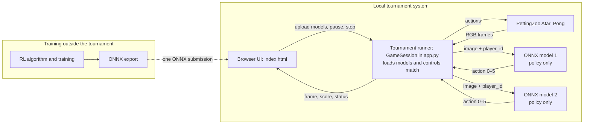

# RL Challenge: Atari Pong

[Deutsche Version](README.md) · **English**

In this challenge, you will work in **pairs** to develop a policy for
**Atari Pong**. In the tournament, your policy will face an opponent that was
unknown during training. You do not modify the game environment. Instead, you
train a policy, submit it as a portable ONNX file, and present your approach
and results in a ten-minute talk.


*Figure: Atari Pong from the [official PettingZoo Pong documentation](https://pettingzoo.farama.org/main/environments/atari/pong/), Farama Foundation.*

## At a glance

| Item | Requirement |
| --- | --- |
| Team | Work in pairs; both members coordinate the method, experiments, and presentation. |
| Technical submission | Exactly one `.onnx` file per team, at most 250 MB, ONNX opset 17. |
| Local test | Load two ONNX models into the browser runner. The second model is only a test opponent, not a second submission. |
| Report | 5–8 pages and the basis of the final grade. |
| Preparation session | 30 October 2026. |
| Presentation and tournament | 13 November 2026; 10 minutes per team, with both team members participating. |

The challenge follows this sequence:

```text
Run the browser runner and baselines locally
        ↓
Understand rules, model interface, and ONNX export
        ↓
Start vanilla DQN on a server or in Colab
        ↓
Run your own experiments in pairs
        ↓
Report, 10-minute presentation, and tournament
```

## 1. Start together: browser runner and baselines

In the first shared step, everyone runs the browser runner **locally** and
examines the three included baselines. No GPU is required. The actual training
is performed separately later on a GPU server or in Google Colab.

```text
install locally → validate baselines → observe a match in the browser
```

### Local setup from scratch

The local runner requires three programs:

| Program | Installation and purpose |
| --- | --- |
| **Git** | Install from [git-scm.com/downloads](https://git-scm.com/downloads/); it downloads and updates the repository. |
| **Python 3.11** | Install from [python.org](https://www.python.org/downloads/); do not accidentally use a different Python version. On Windows, enable the option that adds Python to `PATH`. |
| **Visual Studio Code** | Optionally install from [code.visualstudio.com](https://code.visualstudio.com/download); it provides an editor and integrated terminal. Any other editor and terminal will also work. |

Next, open a terminal or PowerShell and verify the installation.

macOS and Linux:

```bash
git --version
python3.11 --version
```

Windows PowerShell:

```powershell
git --version
py -3.11 --version
```

Both commands must print a version number. Then download the public repository;
this does not require a GitHub account:

```bash
git clone https://github.com/georgmerz/rl-challenge.git
cd rl-challenge
```

Open the folder in VS Code via **File → Open Folder**. If the `code` command is
configured, `code .` is an equivalent shortcut.

#### Virtual Python environment on macOS or Linux

The virtual environment keeps this project's packages separate from other
Python projects:

```bash
python3.11 -m venv .venv
source .venv/bin/activate
python -m pip install --upgrade pip
python -m pip install --prefer-binary -r requirements-runner.txt
AutoROM --accept-license
```

#### Virtual Python environment on Windows

```powershell
py -3.11 -m venv .venv
.venv\Scripts\Activate.ps1
python -m pip install --upgrade pip
python -m pip install --prefer-binary -r requirements-runner.txt
AutoROM --accept-license
```

If PowerShell blocks activation, run
`Set-ExecutionPolicy -Scope Process Bypass` first in that terminal. During
later work in a new terminal, only reactivate the environment; packages and
the ROM do not need to be installed again.

This command checks the installation and Pong ROM:

```bash
python -c "from pettingzoo.atari import pong_v3; env = pong_v3.parallel_env(); env.reset(seed=42); env.close(); print('Setup and Pong ROM: OK')"
```

The last line must read `Setup and Pong ROM: OK`. If `git`, `python3.11`, or
`py -3.11` already fails, fix that installation or its `PATH` configuration
before continuing.

### Shared walkthrough in class

#### 1. Validate the three included policies

```bash
python validate_submission.py baselines/baseline_pong_static.onnx
python validate_submission.py baselines/baseline_pong_reactive.onnx
python validate_submission.py baselines/baseline_pong_track_ball.onnx
```

All validator calls must end with `OK`. This demonstrates an important
difference: a model can be technically valid while still playing poorly.

#### 2. Run a browser match

```bash
PORT=5001 python app.py
```

On Windows PowerShell, use `$env:PORT=5001; python app.py`. Then open
[http://127.0.0.1:5001](http://127.0.0.1:5001) and select:

| File | Purpose |
| --- | --- |
| `baselines/baseline_pong_static.onnx` | Intentionally weak policy that always returns `FIRE`; useful for testing upload and interface compatibility. |
| `baselines/baseline_pong_reactive.onnx` | Intermediate policy that tracks the ball only on its own half of the field; useful as an easier training opponent. |
| `baselines/baseline_pong_track_ball.onnx` | Deterministic image-based policy that locates the ball and its paddle using pixel colors. It is not a trained model. |

Try **Start**, **Pause**, **Resume**, and **Stop**, and observe the side changes
and score. This completes the local part. The first short training and export
run follows separately on the server or in Colab in
[Section 4](#4-training-vanilla-dqn-on-a-server-or-in-colab).

After the walkthrough, you should be able to:

- validate an existing ONNX policy and load it in the runner,
- explain the difference between technical validity and playing strength,
- identify `image`, `player_id`, and `action` in the model contract, and
- clearly distinguish training from local tournament execution.

If a step fails, first check whether the virtual environment is active,
whether `requirements-runner.txt` was installed, and whether
`AutoROM --accept-license` completed. If port 5001 is in use, choose another
port such as 5002.

## 2. Rules, model specification, and export

The policy must return the ball with its paddle and get it past the opponent.
The actual tournament opponent is unknown during training. The browser runner
therefore compares two independently uploaded models.

> **Authoritative tournament rules:** [`app.py`](app.py) defines the number of
> rounds, side changes, seeds, timeout, tournament points, winner, and ONNX
> interface. PettingZoo/ALE defines Pong mechanics, actions, and environment
> rewards. Rules used by a training example, such as its training timeout, do
> not automatically apply to the tournament.

### Match rules

A match consists of ten rounds with fixed, reproducible seeds and alternating
sides:

| Round | Seed | Upload “Player 1” | Upload “Player 2” |
| ---: | ---: | --- | --- |
| 1, 3, 5, 7, 9 | 42, 44, 46, 48, 50 | left/orange (`player_id=1`) | right/green (`player_id=2`) |
| 2, 4, 6, 8, 10 | 43, 45, 47, 49, 51 | right/green (`player_id=2`) | left/orange (`player_id=1`) |

Each model therefore plays five rounds on each side. In each round:

- A positive environment reward gives one tournament point to the associated
  upload, and the next round begins.
- After at most **2,000** environment steps without a positive point, or after
  a technical termination without a positive point, the round is a draw. Both
  uploads receive one tournament point.
- A negative reward alone is not recorded as a separate tournament point.
- After ten rounds, the upload with more tournament points wins. Equal scores
  result in a draw.

The browser shows the score and current sides. A match can be paused, resumed,
or stopped. Stopping ends it without determining a winner afterwards.

### Architecture: training is separate from the tournament runner

| Component | Responsibility |
| --- | --- |
| Arena | Two-player [PettingZoo Atari Pong (`pong_v3`)](https://pettingzoo.farama.org/main/environments/atari/pong/). |
| Browser UI | [`index.html`](index.html) selects two models and displays the arena, score, and status. |
| Tournament runner | `GameSession` in [`app.py`](app.py) loads both ONNX models and manages inference, frame stacks, side changes, rounds, and points. |
| Model | Pure ONNX policy inference. It receives only `image` and `player_id` and returns an action. It cannot directly access the environment, score, or opponent action. |
| Training | Your own offline training programs. The repository examples produce ONNX files but are not part of the tournament runner. |



### Public model contract

The runner accepts exactly two inputs and one output with these names, data
types, and fixed shapes:

```text
image:     float32 [1, 12, 210, 160]
player_id: int64   [1]
action:    int64   [1]    # value in {0, 1, 2, 3, 4, 5}
```

Use **ONNX opset 17** and keep the model at or below 250 MB. ONNX Runtime runs
it on the CPU. The runner checks names, types, and fixed shapes. It does not
separately check the opset; another opset might happen to load but would still
violate the submission requirement.

### State / observation

PettingZoo provides one RGB frame per player with shape `210 × 160 × 3`
(`H × W × RGB`, `uint8`). For each physical player, the runner retains the
four most recent frames:

1. At round start, the history contains four copies of the initial frame.
2. After each environment step, the new frame is appended.
3. The runner orders frames from oldest to newest, converts `HWC` to `NCHW`,
   and stacks them into twelve channels.
4. It converts to `float32` and divides by `255`, producing values in `[0, 1]`.

Channels `0–2` contain the oldest RGB frame; channels `9–11` contain the
newest. The sequence allows a policy to estimate movement.

`player_id` represents the **physical side**, not the browser upload slot:

| `player_id` | Side and color |
| ---: | --- |
| `1` | left/orange |
| `2` | right/green |

A model intended for both sides must process both values. It may not remove
the `player_id` input even if it chooses not to use the value internally.

### Actions

The values follow PettingZoo Pong's
[minimal action space](https://pettingzoo.farama.org/main/environments/atari/pong/#action-space-minimal).
The official direction names refer to the Atari controller. In the rotated
display, `RIGHT` and `LEFT` move the paddle up and down on the screen, while
their action numbers remain 2 and 3.

| Value | PettingZoo/ALE meaning |
| ---: | --- |
| `0` | `NOOP` – no input |
| `1` | `FIRE` – fire or serve |
| `2` | `RIGHT` – move right |
| `3` | `LEFT` – move left |
| `4` | `FIRE_RIGHT` – fire and move right |
| `5` | `FIRE_LEFT` – fire and move left |

In particular, action `3` is not `DOWN`, and actions `4`/`5` are not
`FIRE_UP`/`FIRE_DOWN`. `FIRE` can start a rally when the ball is stationary;
Pong also uses a serve timer.

### What is a PyTorch model?

A PyTorch model is a Python class with trainable weights. Its `forward(...)`
method describes how inputs become an output. This deliberately small example
maps `image` and `player_id` to one of the six Pong actions:

```python
import torch
from torch import nn

class TinyPolicy(nn.Module):
    def __init__(self):
        super().__init__()
        self.image_to_q = nn.Sequential(
            nn.AvgPool2d(kernel_size=(21, 20), stride=(21, 20)),
            nn.Flatten(),
            nn.Linear(12 * 10 * 8, 6),
        )
        self.side_bias = nn.Embedding(3, 6)  # entries for player_id 1 and 2

    def forward(self, image, player_id):
        q_values = self.image_to_q(image) + self.side_bias(player_id)
        return torch.argmax(q_values, dim=1).to(torch.int64)

model = TinyPolicy()
```

PyTorch is installed with the full training dependencies in Section 4; it is
not required for the local browser runner in Section 1.

The layers and their connections form the **architecture**; the numbers in
`Linear` and `Embedding` are the trainable **weights**. Training changes these
weights. During inference, `forward` only performs the computation and returns
an action. The example is intentionally small and untrained—it demonstrates
the form, but it is not a strong Pong policy.

PyTorch/SB3 checkpoints (`.pt`, `.pth`, `.zip`) are used to resume training.
The submitted artifact is the exported `.onnx` file instead.

### What is ONNX?

**ONNX** (*Open Neural Network Exchange*) is a portable format for trained
neural networks. Export converts the PyTorch computation needed for inference
into a standardized computation graph with fixed weights. The tournament
runner therefore requires neither your training code nor PyTorch. It loads
only the `.onnx` file with ONNX Runtime on the CPU.

```text
PyTorch / Stable-Baselines3 training → ONNX export → browser runner
        learned weights                fixed API       inference only
```

The file contains the model architecture and learned weights for inference,
but not the replay buffer, optimizer, training data, or Python classes. It is
the **technical submission** and must implement the interface described above.

A basic PyTorch export looks like this:

```python
model.eval()
image = torch.zeros((1, 12, 210, 160), dtype=torch.float32)
player_id = torch.ones((1,), dtype=torch.int64)
torch.onnx.export(
    model, (image, player_id), "my_policy.onnx",
    input_names=["image", "player_id"], output_names=["action"], opset_version=17,
)
```

The model's `forward` method must return a valid `int64` action. Validate the
result with `python validate_submission.py my_policy.onnx`. See the
[official PyTorch ONNX documentation](https://docs.pytorch.org/docs/stable/onnx.html)
for more details. The validator checks CPU execution, the interface, and the
action range, but it does not completely verify playing strength, file size,
or the ONNX opset.

## 3. Understanding the vanilla DQN example

The repository intentionally contains **no finished competition solution**.
The [`train_dqn_vanilla.py`](train_dqn_vanilla.py) script demonstrates a
minimal complete training pipeline:

```text
Pong against ONNX opponent → preprocessing → DQN training
        → checkpoint → ONNX export → validator → browser runner
```

| File | Role in the example |
| --- | --- |
| [`pong_opponent_env.py`](pong_opponent_env.py) | Converts the two-player game into a Gymnasium environment: one side learns while a selectable ONNX model controls the other side. |
| [`train_dqn_vanilla.py`](train_dqn_vanilla.py) | Defines preprocessing, the CNN, DQN, checkpoints, and final ONNX export. |
| [`train_qrdqn_vanilla.py`](train_qrdqn_vanilla.py) | Optional QR-DQN variant using the same environment, preprocessing, and ONNX output. |

The example works as follows:

1. `PongVsOnnxEnv` trains one side per episode while the ONNX opponent controls
   the other. `--player-id 0` randomly selects the training side per episode;
   `1` and `2` force left and right.
2. `PongPreprocessor` crops the playing field and compresses four RGB frames
   into four `84 × 84` grayscale images. A fifth channel encodes the side. The
   same module is embedded into the exported ONNX policy, keeping the replay
   buffer small without changing the public contract.
3. DQN learns from the unchanged Pong reward and writes both an SB3 `.zip`
   checkpoint and an `.onnx` file every `--export-every` steps.

The `.onnx` files are for the browser and submission; the `.zip` files are for
continuing or inspecting SB3 training. The 1,000-step timeout, DQN, and fixed
opponent are choices made by this example, not tournament rules.

The optional `train_qrdqn_vanilla.py` file uses the same setup with QR-DQN.
For the shared introduction, `train_dqn_vanilla.py` remains the clearer main
path.

## 4. Training vanilla DQN on a server or in Colab

Longer training runs belong on a GPU server or in Google Colab. The result of
this part is an `.onnx` file. Transfer it to the local computer and check it
there with the validator and browser runner. The GPU is used only for
training; tournament inference later uses ONNX Runtime on the CPU.

### Option 1 – GPU server

#### Set up the server once from scratch

First connect to the server via SSH. The university or server operator will
provide the host name and user name:

```bash
ssh USERNAME@SERVERNAME
```

Clone the repository into your home directory and create an isolated Python
environment:

```bash
git clone https://github.com/georgmerz/rl-challenge.git
cd rl-challenge
python3.11 -m venv .venv
source .venv/bin/activate
python -m pip install --upgrade pip
python -m pip install --prefer-binary -r requirements.txt
AutoROM --accept-license
```

In addition to the local runner packages, the full `requirements.txt` includes
PyTorch, DQN/QR-DQN, and ONNX export. Check whether PyTorch detects the server
GPU:

```bash
python -c "import torch; print('PyTorch:', torch.__version__); print('CUDA:', torch.cuda.is_available()); print('GPU:', torch.cuda.get_device_name(0) if torch.cuda.is_available() else 'none')"
```

GPU training requires `CUDA: True`. If it prints `False`, do not accidentally
start a long CPU run. Check the PyTorch build required by the server driver or
the operator's installation instructions.

On later logins, entering the repository, activating the environment, and
updating the checkout are sufficient:

```bash
cd ~/rl-challenge
source .venv/bin/activate
git pull --ff-only
```

On a shared GPU server, use `nvidia-smi` before every run to select a free GPU.
Set the following variable to that GPU's number and do not claim a device whose
memory is already heavily occupied:

```bash
nvidia-smi
gpu_id=2
```

### Short technical test

Before a long run, test the environment, GPU, and ONNX export together:

```bash
CUDA_VISIBLE_DEVICES="$gpu_id" python train_dqn_vanilla.py \
  --device cuda \
  --timesteps 128 \
  --export-every 128 \
  --output baselines/dqn_smoke.onnx
python validate_submission.py baselines/dqn_smoke.onnx
```

This test does not measure playing strength and performs no learning updates,
because the example starts learning only after 5,000 steps.

### Start a long run in the background

`nohup` keeps the training process running after the terminal or VS Code SSH
connection closes. A unique run ID prevents older models and logs from being
overwritten:

```bash
mkdir -p logs
run_id="dqn_$(date +%Y%m%d_%H%M%S)"

nohup env CUDA_VISIBLE_DEVICES="$gpu_id" python -u train_dqn_vanilla.py \
  --device cuda \
  --timesteps 1000000 \
  --export-every 100000 \
  --player-id 0 \
  --opponent baselines/baseline_pong_reactive.onnx \
  --output "baselines/${run_id}.onnx" \
  > "logs/${run_id}.log" 2>&1 &

train_pid=$!
echo "$train_pid" > "logs/${run_id}.pid"
echo "Run: $run_id"
echo "PID: $train_pid"
echo "Log: logs/${run_id}.log"
```

The message `nohup: ignoring input` is normal. These hyperparameters and the
fixed opponent are only a starting point, not challenge rules. For a
particularly easy diagnostic run, use `baseline_pong_static.onnx` instead.

### Monitor and stop a run

In the same terminal, the following command continuously displays the log.
`Ctrl+C` stops only the display, not the training process:

```bash
tail -f "logs/${run_id}.log"
```

After logging in again, find the most recently started run as follows:

```bash
latest_log=$(ls -t logs/dqn_*.log | head -n 1)
run_id=$(basename "$latest_log" .log)
pid_file="${latest_log%.log}.pid"
tail -n 50 "$latest_log"
ps -p "$(cat "$pid_file")" -o pid,etime,cmd
```

Only when this exact run should be terminated:

```bash
kill "$(cat "$pid_file")"
```

Every `--export-every` steps, `.onnx` and `.zip` checkpoints appear in
`baselines/`. Use `.onnx` for the validator, browser, and submission; `.zip`
contains the SB3 training state. After normal completion, validate the final
model at `baselines/${run_id}.onnx`:

```bash
python validate_submission.py "baselines/${run_id}.onnx"
ls -lh "baselines/${run_id}"*.onnx
```

For CPU training, omit `CUDA_VISIBLE_DEVICES` and use `--device cpu`. On an
Apple Silicon Mac, `--device mps` can be used.

### Option 2 – Google Colab

If no GPU server is available, use the prepared notebook with the same
repository in Colab:

[](https://colab.research.google.com/github/georgmerz/rl-challenge/blob/main/RL_Challenge_Colab.ipynb)

The notebook clones the repository, installs the training dependencies and
Atari ROMs, and executes the DQN/ONNX workflow. Before training, select a GPU
under **Runtime → Change runtime type**. Colab storage is temporary; download
the finished `.onnx` file before the session ends.

### Test the trained ONNX model locally

For a server run, download the finished file with the VS Code file explorer or
copy it from a **local** terminal:

```bash
scp USERNAME@SERVERNAME:~/rl-challenge/baselines/MY_MODEL.onnx .
```

Then validate it in the local repository and load it against an included
baseline in the runner:

```bash
python validate_submission.py MY_MODEL.onnx
PORT=5001 python app.py
```

Only the `.onnx` file is tested locally and submitted. An SB3 checkpoint with
the `.zip` extension is only used to resume training and cannot be loaded by
the tournament runner.

## 5. Formal challenge requirements

### Working in pairs

After the shared walkthrough, work in pairs. Both team members should be able
to explain the complete system even if individual tasks are divided. Agree on
the method, experiments, report, and presentation, and record decisions and
experimental results throughout the project.

### Questions for your own experiment

The vanilla example is an entry point, not a competition solution. Select at
least one justified question and compare variants under identical conditions,
for example:

- How does another training opponent or an opponent pool affect performance?
- Does a different preprocessing method or network architecture work better?
- Does reward shaping help, and what undesirable behavior can it create?
- How do models trained on the left, right, or both sides differ?

A GPU accelerates longer runs but is not a methodological requirement.

### What should the report discuss?

The report should not merely describe finished code. It should tell a coherent
**experimental story**: Which decision was made, why was it made, how was it
tested, and what follows from the results? The following structure is suitable
for 5–8 pages.

#### Task, state, and actions

- How do Pong, rallies, scoring, and rewards work? Which information is and is
  not available to the policy?
- Why were four RGB frames used directly or preprocessed internally? What
  movement information can be inferred?
- How are the six actions, environment reward, and `player_id` interpreted?

#### Method and training

- Which RL algorithm and architecture were selected, and why do they suit the
  task?
- Was the original reward used, or was reward shaping applied? Which intended
  and unintended incentives result?
- Was training performed against fixed opponents, self-play, or an opponent
  pool?
- How was the policy trained for both sides and protected against overfitting
  to one opponent or a few seeds?
- Which training duration, hyperparameters, hardware, and checkpoint-selection
  criteria were used?

#### Evaluation and results

- Against which baselines and models was the policy evaluated **without
  further learning**?
- Did evaluation cover multiple seeds, both sides, and enough rallies?
- Which metrics meaningfully describe playing strength, such as
  wins/losses/draws, point ratio, and variation?
- What do learning curves, tables, or videos show? A few well-explained
  results are more useful than many uncommented outputs.
- Which failure cases, limitations, or surprising behaviors were observed?
  What would be the next reasonable improvement?

Clearly separate training results from evaluation. The ten-round browser
tournament is a shared final test, but it is not sufficient by itself to
measure general playing strength. Your evaluation should therefore include
additional seeds, both sides, and preferably multiple opponent types. Record
commands, software versions, hardware, and key hyperparameters so the
experiment can be reproduced.

### Agenda for the 10-minute presentation

On **13 November 2026**, each pair presents its approach and results and then
takes part in the tournament. The presentation should be a concise version of
the report, not a guided tour through source code. Both team members contribute
substantive content.

A possible schedule is:

| Time | Content |
| ---: | --- |
| about 1 minute | Task, objective, and research question |
| about 3 minutes | State/preprocessing, algorithm, reward, and training opponents |
| about 4 minutes | Evaluation, main results, and baseline comparison |
| about 2 minutes | Limitations, surprising observations, and conclusion |

An architecture diagram, one meaningful learning curve, and a compact results
table are usually more helpful than many slides of source code. Claims such as
“the model is good” should be supported by evaluation across opponents, seeds,
and both sides. Prepare the tournament model as a validated ONNX file before
the session; live training is not part of the presentation.

### Submission, assessment, and grading scale

Each pair must provide:

- **exactly one `.onnx` file**, at most 250 MB and using ONNX opset 17,
- a **5–8 page report**, and
- a **joint 10-minute presentation**.

An additional project README may be helpful but is not used by the runner.
Before submission, validate the ONNX file and run it locally against a test
opponent:

```bash
python validate_submission.py model.onnx
```

The validator checks technical compatibility, not playing strength. The final
grade is based on the report. Tournament rank and absolute playing strength do
not directly determine the grade; the quality of the method, experiments, and
critical analysis is assessed.

#### Report assessment

| Criterion | Points | Expectation |
| --- | ---: | --- |
| Task and model contract | 15 | Correctly and clearly explain the game, state, actions, reward, `player_id`, and ONNX interface. |
| Method and justification | 25 | Select and justify preprocessing, algorithm, architecture, and optional reward shaping. |
| Training and experimental setup | 20 | Transparently document opponent choice, both sides, hyperparameters, training duration, and checkpoint selection. |
| Evaluation and critical discussion | 30 | Use meaningful baselines, seeds, metrics, and comparisons; interpret results, limitations, and failure cases. |
| Clarity and reproducibility | 10 | Structure the report clearly, label figures, and document commands, versions, and hardware. |
| **Total** | **100** | |

#### Grading scale

| Points | Grade |
| ---: | :--- |
| 95–100 | 1.0 |
| 90–94 | 1.3 |
| 85–89 | 1.7 |
| 80–84 | 2.0 |
| 75–79 | 2.3 |
| 70–74 | 2.7 |
| 65–69 | 3.0 |
| 60–64 | 3.3 |
| 55–59 | 3.7 |
| 50–54 | 4.0 |
| 0–49 | 5.0 |

The preparation session is on **30 October 2026**. Presentations and the
tournament take place on **13 November 2026**.
