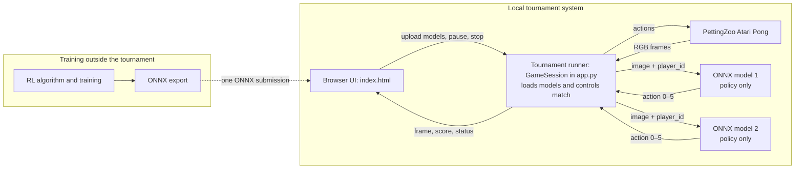

# RL Challenge: Atari Pong

[Deutsche Version](README.md) · **English**

In this challenge, you will work in **pairs** to develop a policy for
**Atari Pong**. In the tournament, your policy will face an opponent that was
unknown during training. You do not modify the game environment. Instead, you
train a policy, submit it as a portable ONNX file, and present your approach
and results in a ten-minute talk.


*Figure: Atari Pong from the [official PettingZoo Pong documentation](https://pettingzoo.farama.org/main/environments/atari/pong/), Farama Foundation.*

## At a glance

| Item | Requirement |
| --- | --- |
| Team | Work in pairs; both members coordinate the method, experiments, and presentation. |
| Technical submission | Exactly one `.onnx` file per team, at most 250 MB, ONNX opset 17. |
| Local test | Load two ONNX models into the browser runner. The second model is only a test opponent, not a second submission. |
| Report | 5–8 pages and the basis of the final grade. |
| Preparation session | 30 October 2026. |
| Presentation and tournament | 13 November 2026; 10 minutes per team, with both team members participating. |

The challenge follows this sequence:

```text
Shared technical walkthrough
        ↓
Experiments in pairs
        ↓
Report (5–8 pages) and final ONNX policy
        ↓
10-minute presentation and tournament
```

## 1. Preparation and shared walkthrough

The goal of the walkthrough is for every participant to execute the complete
pipeline once:

```text
Create baseline → validate ONNX → run match → run DQN briefly → test own export
```

### One-time setup

**Python 3.11** is recommended. The local runner executes ONNX models on the
CPU; a GPU is not required to run a submission.

Alternatively, open the complete shared walkthrough in Google Colab:

[](https://colab.research.google.com/github/georgmerz/rl-challenge/blob/main/RL_Challenge_Colab.ipynb)

The notebook installs the dependencies and Atari ROMs, creates the baselines,
opens the browser runner in a Colab iframe, and executes the short DQN/ONNX
test. Colab storage is temporary, so download generated models before the
runtime ends.

```bash
cd rl-challenge
python -m venv .venv
source .venv/bin/activate
python -m pip install -r requirements.txt
AutoROM --accept-license
```

On Windows, activate the environment with `.venv\Scripts\Activate.ps1`. The
following smoke test also checks whether the Pong ROM is available:

```bash
python -c "from pettingzoo.atari import pong_v3; env = pong_v3.parallel_env(); env.reset(seed=42); env.close(); print('Setup and Pong ROM: OK')"
```

### Run together in class

#### 1. Create and validate two simple policies

```bash
python create_baselines.py
python validate_submission.py baselines/baseline_pong_static.onnx
python validate_submission.py baselines/baseline_pong_track_ball.onnx
```

Both validator calls must end with `OK`. This demonstrates an important
difference: a model can be technically valid while still playing poorly.

#### 2. Run a browser match

```bash
PORT=5001 python app.py
```

On Windows PowerShell, use `$env:PORT=5001; python app.py`. Then open
[http://127.0.0.1:5001](http://127.0.0.1:5001) and select:

| File | Purpose |
| --- | --- |
| `baselines/baseline_pong_static.onnx` | Intentionally weak policy that always returns `FIRE`; useful for testing upload and interface compatibility. |
| `baselines/baseline_pong_track_ball.onnx` | Deterministic image-based policy that locates the ball and its paddle using pixel colors. It is not a trained model. |

Try **Start**, **Pause**, **Resume**, and **Stop**, and observe the side changes
and score.

#### 3. Execute training and export once

Activate the virtual environment in a second terminal and run:

```bash
python train_dqn_vanilla.py --timesteps 128 --export-every 128 \
  --output baselines/lecture_smoke.onnx
python validate_submission.py baselines/lecture_smoke.onnx
```

This run tests the environment, DQN setup, checkpoints, and ONNX export. It
does not train a useful policy because DQN updates only begin after 5,000
steps. You can nevertheless load `lecture_smoke.onnx` into the browser against
a baseline. Every participant has now completed the future submission path.

After the walkthrough, you should be able to:

- create and validate a technically compatible ONNX policy,
- explain the difference between technical validity and playing strength,
- identify `image`, `player_id`, and `action` in the model contract, and
- locate the tournament rules, training adapter, and model implementation.

### Recommended code-reading order

| File | Guiding question |
| --- | --- |
| [`create_baselines.py`](create_baselines.py) | How does a simple policy become an ONNX file? |
| [`validate_submission.py`](validate_submission.py) | What does technical validation check, and what does it not check? |
| [`app.py`](app.py) | How does the runner call two models and score a match? |
| [`pong_opponent_env.py`](pong_opponent_env.py) | How is the two-player arena adapted for a single learning agent? |
| [`train_dqn_vanilla.py`](train_dqn_vanilla.py) | How do preprocessing, DQN, checkpoints, and export fit together? |

If a step fails, first check whether the virtual environment is active,
whether `requirements.txt` was installed, and whether
`AutoROM --accept-license` completed. If port 5001 is in use, choose another
port such as 5002.

## 2. Task and tournament process

The policy must return the ball with its paddle and get it past the opponent.
The actual tournament opponent is unknown during training. The browser runner
therefore compares two independently uploaded models.

> **Authoritative tournament rules:** [`app.py`](app.py) defines the number of
> rounds, side changes, seeds, timeout, tournament points, winner, and ONNX
> interface. PettingZoo/ALE defines Pong mechanics, actions, and environment
> rewards. Rules used by a training example, such as its training timeout, do
> not automatically apply to the tournament.

### Architecture: training is separate from the tournament runner

| Component | Responsibility |
| --- | --- |
| Arena | Two-player [PettingZoo Atari Pong (`pong_v3`)](https://pettingzoo.farama.org/main/environments/atari/pong/). |
| Browser UI | [`index.html`](index.html) selects two models and displays the arena, score, and status. |
| Tournament runner | `GameSession` in [`app.py`](app.py) loads both ONNX models and manages inference, frame stacks, side changes, rounds, and points. |
| Model | Pure ONNX policy inference. It receives only `image` and `player_id` and returns an action. It cannot directly access the environment, score, or opponent action. |
| Training | Your own offline training programs. The repository examples produce ONNX files but are not part of the tournament runner. |



### What is ONNX?

**ONNX** (*Open Neural Network Exchange*) is a portable format for trained
neural networks. You can train a model with PyTorch and export it as an
`.onnx` file. The tournament runner does not require your training code or
PyTorch. It loads only the ONNX file with ONNX Runtime on the CPU.

```text
PyTorch / Stable-Baselines3 training → ONNX export → browser runner
        learned weights                fixed API       inference only
```

The file contains the model architecture and learned weights for inference,
but not the replay buffer, optimizer, training data, or Python classes. It is
the **technical submission** and must implement the interface in Section 3.

A basic PyTorch export looks like this:

```python
model.eval()
image = torch.zeros((1, 12, 210, 160), dtype=torch.float32)
player_id = torch.ones((1,), dtype=torch.int64)
torch.onnx.export(
    model, (image, player_id), "my_policy.onnx",
    input_names=["image", "player_id"], output_names=["action"], opset_version=17,
)
```

The model's `forward` method must return a valid `int64` action. Validate the
result with `python validate_submission.py my_policy.onnx`. See the
[official PyTorch ONNX documentation](https://docs.pytorch.org/docs/stable/onnx.html)
for more details. The validator checks CPU execution, the interface, and the
action range, but it does not completely verify playing strength, file size,
or the ONNX opset.

### Match rules

A match consists of ten rounds with fixed, reproducible seeds and alternating
sides:

| Round | Seed | Upload “Player 1” | Upload “Player 2” |
| ---: | ---: | --- | --- |
| 1, 3, 5, 7, 9 | 42, 44, 46, 48, 50 | left/orange (`player_id=1`) | right/green (`player_id=2`) |
| 2, 4, 6, 8, 10 | 43, 45, 47, 49, 51 | right/green (`player_id=2`) | left/orange (`player_id=1`) |

Each model therefore plays five rounds on each side. In each round:

- A positive environment reward gives one tournament point to the associated
  upload, and the next round begins.
- After at most **2,000** environment steps without a positive point, or after
  a technical termination without a positive point, the round is a draw. Both
  uploads receive one tournament point.
- A negative reward alone is not recorded as a separate tournament point.
- After ten rounds, the upload with more tournament points wins. Equal scores
  result in a draw.

The browser shows the score and current sides. A match can be paused, resumed,
or stopped. Stopping ends it without determining a winner afterwards.

## 3. What must the model implement?

### Public model contract

The runner accepts exactly two inputs and one output with these names, data
types, and fixed shapes:

```text
image:     float32 [1, 12, 210, 160]
player_id: int64   [1]
action:    int64   [1]    # value in {0, 1, 2, 3, 4, 5}
```

Use **ONNX opset 17** and keep the model at or below 250 MB. ONNX Runtime runs
it on the CPU. The runner checks names, types, and fixed shapes. It does not
separately check the opset; another opset might happen to load but would still
violate the submission requirement.

### State / observation

PettingZoo provides one RGB frame per player with shape `210 × 160 × 3`
(`H × W × RGB`, `uint8`). For each physical player, the runner retains the
four most recent frames:

1. At round start, the history contains four copies of the initial frame.
2. After each environment step, the new frame is appended.
3. The runner orders frames from oldest to newest, converts `HWC` to `NCHW`,
   and stacks them into twelve channels.
4. It converts to `float32` and divides by `255`, producing values in `[0, 1]`.

Channels `0–2` contain the oldest RGB frame; channels `9–11` contain the
newest. The sequence allows a policy to estimate movement.

`player_id` represents the **physical side**, not the browser upload slot:

| `player_id` | Side and color |
| ---: | --- |
| `1` | left/orange |
| `2` | right/green |

A model intended for both sides must process both values. It may not remove
the `player_id` input even if it chooses not to use the value internally.

### Actions

The values follow PettingZoo Pong's
[minimal action space](https://pettingzoo.farama.org/main/environments/atari/pong/#action-space-minimal).
The official direction names refer to the Atari controller. In the rotated
display, `RIGHT` and `LEFT` move the paddle up and down on the screen, while
their action numbers remain 2 and 3.

| Value | PettingZoo/ALE meaning |
| ---: | --- |
| `0` | `NOOP` – no input |
| `1` | `FIRE` – fire or serve |
| `2` | `RIGHT` – move right |
| `3` | `LEFT` – move left |
| `4` | `FIRE_RIGHT` – fire and move right |
| `5` | `FIRE_LEFT` – fire and move left |

In particular, action `3` is not `DOWN`, and actions `4`/`5` are not
`FIRE_UP`/`FIRE_DOWN`. `FIRE` can start a rally when the ball is stationary;
Pong also uses a serve timer.

## 4. Project work in pairs

After the shared walkthrough, work in pairs. Both team members should be able
to explain the complete system, even if individual tasks are divided. Agree on:

- the research question or improvement you want to investigate,
- state design, preprocessing, reward, and algorithm,
- training opponents and player sides,
- experiments that enable a fair comparison, and
- responsibility for each part of the joint presentation.

Record decisions and experimental results as you work so that the report and
presentation grow from the experiments instead of being reconstructed later.

### The DQN example as a shared starting point

The repository intentionally contains **no finished competition solution**.
The DQN example does, however, demonstrate the complete technical pipeline:

```text
Pong against ONNX opponent → preprocessing → DQN training
        → checkpoint → ONNX export → validator → browser runner
```

| File | Role in the example |
| --- | --- |
| [`pong_opponent_env.py`](pong_opponent_env.py) | Converts the two-player game into a Gymnasium environment: one side learns while a selectable ONNX model controls the other side. |
| [`train_dqn_vanilla.py`](train_dqn_vanilla.py) | Defines preprocessing, the CNN, DQN, checkpoints, and final ONNX export. |

The 128-step run from Section 1 is only a technical smoke test. For a first
run that performs DQN updates, use, for example, 100,000 steps:

```bash
python create_baselines.py
python train_dqn_vanilla.py --timesteps 100000 \
  --opponent baselines/baseline_pong_track_ball.onnx \
  --output baselines/baseline_pong_dqn.onnx
python validate_submission.py baselines/baseline_pong_dqn.onnx
```

The example works as follows:

1. `PongVsOnnxEnv` trains one side per episode while the ONNX opponent controls
   the other. `--player-id 0` randomly selects the training side per episode;
   `1` and `2` force left and right.
2. `PongPreprocessor` crops the playing field and compresses four RGB frames
   into four `84 × 84` grayscale images. A fifth channel encodes the side. The
   same module is embedded into the exported ONNX policy, keeping the replay
   buffer small without changing the public contract.
3. DQN learns from the unchanged Pong reward and writes both an SB3 `.zip`
   checkpoint and an `.onnx` file every `--export-every` steps.

The `.onnx` files are for the browser and submission; the `.zip` files are for
continuing or inspecting SB3 training. The 1,000-step timeout, DQN, and fixed
opponent are choices made by this example, not tournament rules.

### From the example to your experiment

Do not adopt the example uncritically. Agree on at least one justified
question, for example:

- How does another training opponent or an opponent pool affect performance?
- Does a different preprocessing method or network architecture work better?
- Does reward shaping help, and what undesirable behavior can it create?
- How do models trained on the left, right, or both sides differ?

Compare variants under identical conditions. The example is an entry point,
not a reference for fair tournament evaluation. Training can run on CPU,
Apple Silicon, or CUDA. A GPU accelerates longer runs but is not mandatory.

## 5. What should the report discuss?

The report should not merely describe finished code. It should tell a coherent
**experimental story**: Which decision was made, why was it made, how was it
tested, and what follows from the results? The following structure is suitable
for 5–8 pages.

### Task, state, and actions

- How do Pong, rallies, scoring, and rewards work? Which information is and is
  not available to the policy?
- Why were four RGB frames used directly or preprocessed internally? What
  movement information can be inferred?
- How are the six actions, environment reward, and `player_id` interpreted?

### Method and training

- Which RL algorithm and architecture were selected, and why do they suit the
  task?
- Was the original reward used, or was reward shaping applied? Which intended
  and unintended incentives result?
- Was training performed against fixed opponents, self-play, or an opponent
  pool?
- How was the policy trained for both sides and protected against overfitting
  to one opponent or a few seeds?
- Which training duration, hyperparameters, hardware, and checkpoint-selection
  criteria were used?

### Evaluation and results

- Against which baselines and models was the policy evaluated **without
  further learning**?
- Did evaluation cover multiple seeds, both sides, and enough rallies?
- Which metrics meaningfully describe playing strength, such as
  wins/losses/draws, point ratio, and variation?
- What do learning curves, tables, or videos show? A few well-explained
  results are more useful than many uncommented outputs.
- Which failure cases, limitations, or surprising behaviors were observed?
  What would be the next reasonable improvement?

Clearly separate training results from evaluation. The ten-round browser
tournament is a shared final test, but it is not sufficient by itself to
measure general playing strength. Your evaluation should therefore include
additional seeds, both sides, and preferably multiple opponent types. Record
commands, software versions, hardware, and key hyperparameters so the
experiment can be reproduced.

## 6. The 10-minute presentation

On **13 November 2026**, each pair presents its approach and results and then
takes part in the tournament. The presentation should be a concise version of
the report, not a guided tour through source code. Both team members contribute
substantive content.

A possible schedule is:

| Time | Content |
| ---: | --- |
| about 1 minute | Task, objective, and research question |
| about 3 minutes | State/preprocessing, algorithm, reward, and training opponents |
| about 4 minutes | Evaluation, main results, and baseline comparison |
| about 2 minutes | Limitations, surprising observations, and conclusion |

An architecture diagram, one meaningful learning curve, and a compact results
table are usually more helpful than many slides of source code. Claims such as
“the model is good” should be supported by evaluation across opponents, seeds,
and both sides. Prepare the tournament model as a validated ONNX file before
the session; live training is not part of the presentation.

## 7. Submission, assessment, and grading scale

Each pair must provide:

- **exactly one `.onnx` file**, at most 250 MB and using ONNX opset 17,
- a **5–8 page report**, and
- a **joint 10-minute presentation**.

An additional project README may be helpful but is not used by the runner.
Before submission, validate the ONNX file and run it locally against a test
opponent:

```bash
python validate_submission.py model.onnx
```

The validator checks technical compatibility, not playing strength. The final
grade is based on the report. Tournament rank and absolute playing strength do
not directly determine the grade; the quality of the method, experiments, and
critical analysis is assessed.

### Report assessment

| Criterion | Points | Expectation |
| --- | ---: | --- |
| Task and model contract | 15 | Correctly and clearly explain the game, state, actions, reward, `player_id`, and ONNX interface. |
| Method and justification | 25 | Select and justify preprocessing, algorithm, architecture, and optional reward shaping. |
| Training and experimental setup | 20 | Transparently document opponent choice, both sides, hyperparameters, training duration, and checkpoint selection. |
| Evaluation and critical discussion | 30 | Use meaningful baselines, seeds, metrics, and comparisons; interpret results, limitations, and failure cases. |
| Clarity and reproducibility | 10 | Structure the report clearly, label figures, and document commands, versions, and hardware. |
| **Total** | **100** | |

### Grading scale

| Points | Grade |
| ---: | :--- |
| 95–100 | 1.0 |
| 90–94 | 1.3 |
| 85–89 | 1.7 |
| 80–84 | 2.0 |
| 75–79 | 2.3 |
| 70–74 | 2.7 |
| 65–69 | 3.0 |
| 60–64 | 3.3 |
| 55–59 | 3.7 |
| 50–54 | 4.0 |
| 0–49 | 5.0 |

The preparation session is on **30 October 2026**. Presentations and the
tournament take place on **13 November 2026**.
